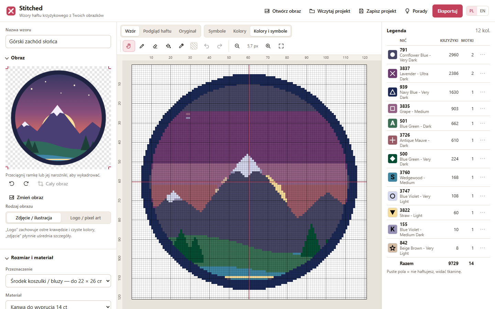
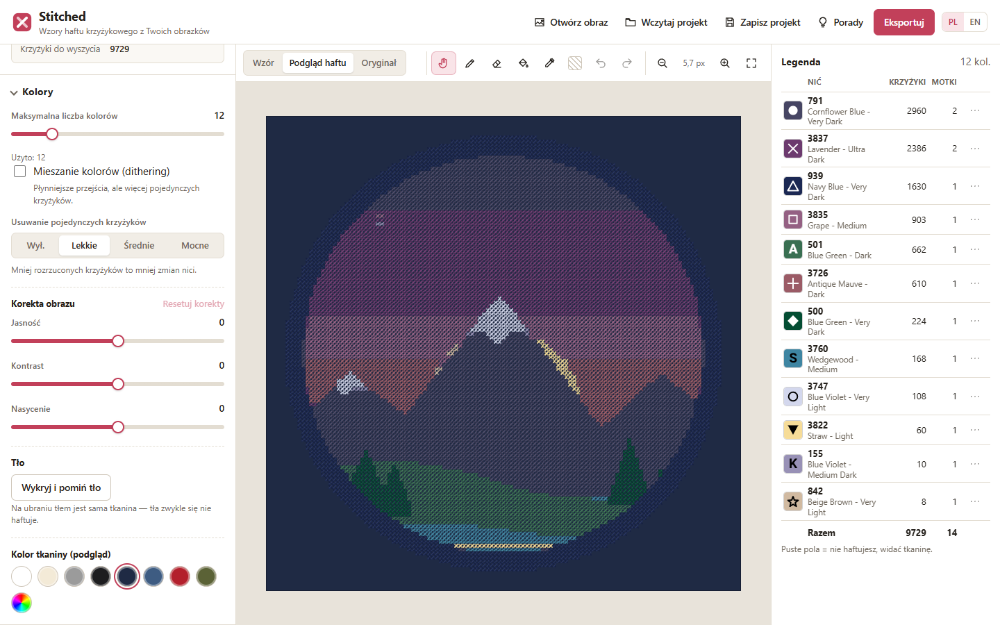
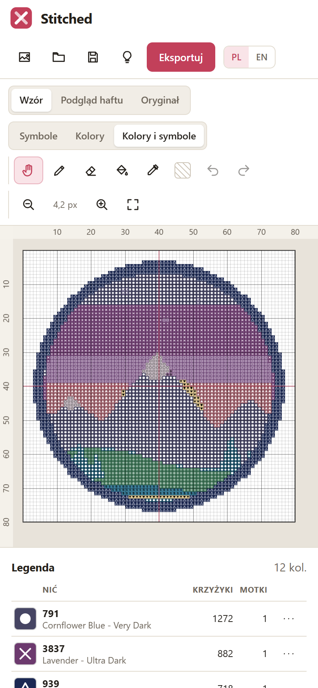
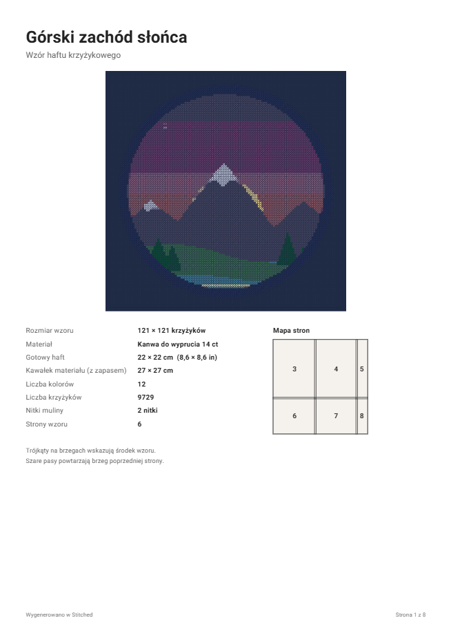
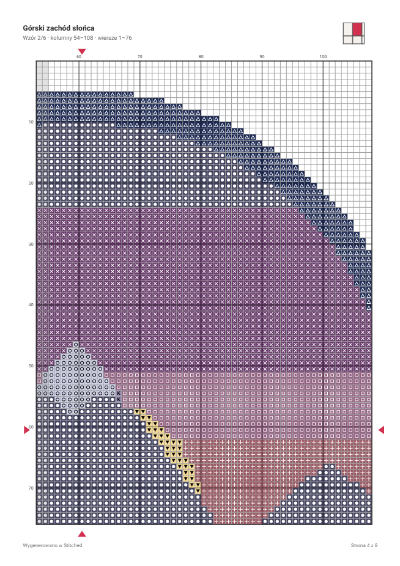
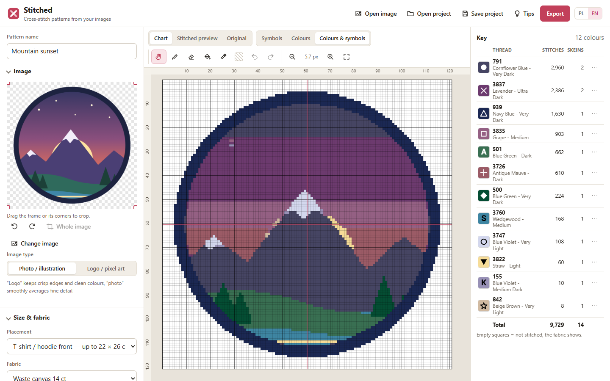

# Stitched

**Zamień dowolny obrazek we wzór do haftu krzyżykowego dopasowany do miejsca na ubraniu.**
Wybierz rozmiar (np. logo na piersi, plecy bluzy, czapka), ogranicz liczbę kolorów nici DMC
i pobierz gotowy wzór do druku w PDF.

### ▶ [Otwórz aplikację](https://GITHUB_USER.github.io/Stitched/)

Działa w przeglądarce na komputerze, tablecie i telefonie. Niczego nie trzeba instalować,
a obraz nie opuszcza Twojego urządzenia, bo wszystko liczy się lokalnie.



_[English below](#english)_

## Co potrafi

- **Rozmiar pod ubranie**: gotowe miejsca, m.in. logo na piersi, środek koszulki, plecy
  bluzy, rękaw, kieszonka, przód czapki, plecy kurtki jeansowej, body niemowlęce, torba
  i naszywka. Obrazek dopasowuje się do miejsca z zachowaniem proporcji. Możesz też wpisać
  własny rozmiar w centymetrach albo w krzyżykach.
- **Materiały**: Aida 11–20 ct, len/evenweave 25–36 ct (haft przez 2 nitki) oraz
  **kanwa do wyprucia** (waste canvas) 8,5–14 ct, której używa się do haftu na ubraniach.
  Aplikacja pokazuje gotowy rozmiar w cm i calach oraz potrzebny kawałek materiału.
- **Kolory**: limit 2–60 kolorów z palety **454 nici DMC**. Kolory dobierane są tak, jak widzi
  je oko (k-means w przestrzeni CIELAB i porównanie CIEDE2000). Możesz też:
  - włączyć dithering;
  - usunąć osamotnione krzyżyki („konfetti”);
  - poprawić jasność, kontrast i nasycenie;
  - pominąć tło: na ubraniu tłem jest sama tkanina;
  - zamienić albo wykluczyć wybrane nici.
- **Podgląd haftu** na wybranym kolorze tkaniny, np. czarnej bluzie albo granatowej koszulce.
- **Ręczne poprawki**: ołówek, gumka, wypełnianie i pipeta, z cofaniem i ponawianiem.
- **Legenda** z liczbą krzyżyków i szacowaną liczbą motków dla każdego koloru.
- **Eksport do PDF**:
  - strona tytułowa z podglądem i mapą stron;
  - legenda;
  - wzór podzielony na strony A4 lub Letter, z numeracją, zakładką między stronami
    i znacznikami środka;
  - wersja czarno-biała (symbole) albo kolorowa.
- **Eksport do PNG** (wzór albo podgląd) oraz **zapis i odczyt projektu** (`.stitched.json`).
- Interfejs **po polsku i angielsku**, jasny i ciemny motyw, wersja na telefon.

| Podgląd haftu na granatowej koszulce              | Telefon                                              |
| ------------------------------------------------- | ---------------------------------------------------- |
|  |  |

| PDF: strona tytułowa                                      | PDF: strona wzoru                                      |
| --------------------------------------------------------- | ------------------------------------------------------ |
|  |  |

## Jak zrobić wzór

1. **Otwórz obraz**: przeciągnij plik na stronę albo kliknij „Otwórz obraz”. Wykadruj go
   i w razie potrzeby obróć.
2. **Wybierz przeznaczenie** (np. „Logo na piersi”) albo wpisz własny rozmiar, a potem
   wybierz materiał.
3. **Ustaw liczbę kolorów**. Przy logo i grafikach przełącz „Rodzaj obrazu” na „Logo / pixel art”.
4. **Pomiń tło** przyciskiem „Wykryj i pomiń tło” albo opcją „Nie haftuj” w legendzie.
5. Sprawdź **podgląd haftu** na kolorze swojego ubrania i popraw pojedyncze krzyżyki.
6. Kliknij **Eksportuj** i pobierz PDF do druku. Projekt zapiszesz przyciskiem „Zapisz projekt”.

### Porady: haft na ubraniach

- Wypierz i wyprasuj ubranie przed haftowaniem.
- Użyj kanwy do wyprucia. Przyfastryguj ją, haftuj przez kanwę i materiał, a na koniec
  zwilż kanwę i wyciągnij jej nitki.
- Na rozciągliwych dzianinach (T-shirty, bluzy) podklej od spodu flizelinę stabilizującą.
- Zaczynaj od środka. Czerwone linie i trójkąty na wzorze wskazują środek.

Więcej porad znajdziesz w aplikacji pod przyciskiem **Porady**.

## Wersja offline

Na ekranie startowym jest link **„Pobierz wersję offline”**. To jeden plik HTML, który
działa po otwarciu z dysku, bez internetu. Możesz go też zbudować sam: `npm run build:single`
tworzy plik `dist-single/index.html`.

## Dla programistów

Wymagany jest Node.js 22 lub nowszy.

```bash
npm install
npm run dev          # serwer deweloperski: http://localhost:5173
npm test             # testy jednostkowe (Vitest)
npm run lint         # ESLint
npm run typecheck    # TypeScript
npm run build        # wersja produkcyjna w dist/
npm run build:single # jeden samodzielny plik HTML w dist-single/
node scripts/e2e.mjs          # test end-to-end w przeglądarce (Edge albo --channel=chrome)
node scripts/screenshots.mjs  # zrzuty ekranu do README
```

Stos: TypeScript, React, Vite, jsPDF. Generowanie wzoru działa w Web Workerze.

```
src/core/      logika bez interfejsu (z testami)
  color.ts       sRGB ↔ CIELAB, CIEDE2000
  palettes/      paleta nici DMC
  image.ts       obrót, kadrowanie, skalowanie do siatki krzyżyków, korekty
  quantize.ts    redukcja kolorów: k-means w Lab ograniczony do palety nici
  cleanup.ts     usuwanie osamotnionych krzyżyków
  sizing.ts      materiały, przeliczanie cm ↔ krzyżyki, presety ubraniowe
  skeins.ts      szacowanie zużycia nici
  pattern.ts     wzór po obróbce (tło, zamiany, ręczne poprawki)
  symbols.ts     symbole wzoru, rysowane tak samo na ekranie i w PDF
src/export/    PDF i PNG
src/render/    rysowanie wzoru i podglądu na canvasie
src/components/ interfejs (React)
src/i18n/      tłumaczenia PL i EN
```

Każdy push do gałęzi `main` uruchamia testy i publikuje aplikację na GitHub Pages
(`.github/workflows/pages.yml`).

## Licencje i źródła danych

- Kod: [MIT](LICENSE).
- Kolory nici DMC: zestawienie z pakietu [sharlagelfand/dmc](https://github.com/sharlagelfand/dmc)
  (MIT). Skrypt `scripts/build-dmc.mjs` odtwarza jego poprawki. Wartości RGB to przybliżenia:
  nić na żywo zawsze trochę różni się od ekranu, więc przed zakupem sprawdź kolory na wzorniku.
- Font Roboto (Apache 2.0), przycięty do znaków łacińskich: `src/assets/fonts/`.
- DMC jest znakiem towarowym Dollfus-Mieg et Compagnie. Ten projekt nie jest powiązany z DMC.

---

## English

**Stitched** turns any image into a cross-stitch pattern sized for a spot on a garment.
It runs entirely in the browser, so your image never leaves your device.
**[Open the app](https://GITHUB_USER.github.io/Stitched/)**

- **Garment presets**: left chest, T-shirt front, hoodie back, sleeve, pocket, cap, denim
  jacket, baby bodysuit, tote bag and patch. Custom sizes work in cm or stitches.
- **Fabrics**: Aida, evenweave (over 2) and waste canvas, with finished size and fabric piece.
- **Colours**: 2–60 colours from 454 DMC threads, perceptual matching (CIELAB k-means and
  CIEDE2000), optional dithering, confetti cleanup, image adjustments, background skipping,
  and thread replacement or exclusion.
- **Stitched preview** on any fabric colour, plus pencil, eraser, fill and picker tools with
  undo and redo.
- **Printable PDF**: cover with page map, key with skein estimates, and a multi-page chart
  with overlap and centre marks. Also PNG export and project files.
- Polish and English UI, dark mode, phone layout, and a single-file offline build.



Development: `npm install`, then `npm run dev`. See the commands above.
Licence: MIT. DMC colour data comes from [sharlagelfand/dmc](https://github.com/sharlagelfand/dmc)
(MIT) and the font is Roboto (Apache 2.0). DMC is a trademark of Dollfus-Mieg et Compagnie;
this project is not affiliated with DMC.
